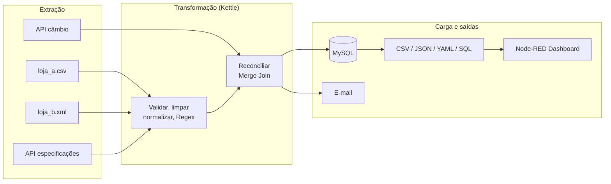
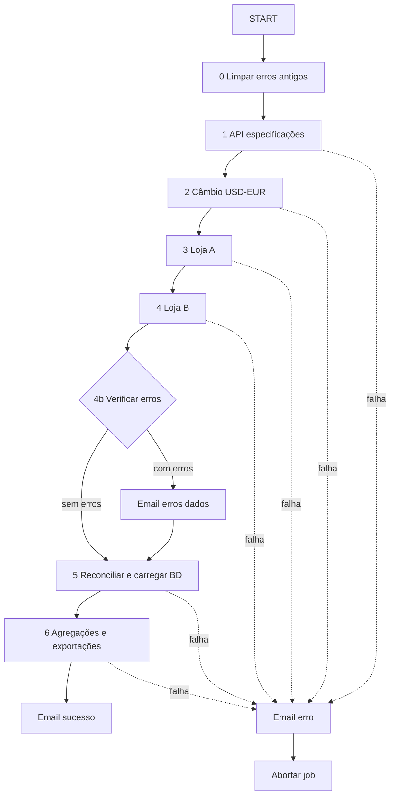

# Pipeline ETL de Reconciliação de Catálogos de Smartphones

> Trabalho Prático I de **Integração de Sistemas de Informação** (ISI), 2026/27
> Licenciatura em Engenharia de Sistemas Informáticos, Escola Superior de Tecnologia, IPCA


Pipeline ETL que integra os catálogos de duas lojas de telemóveis, **TeleCompra** (CSV) e **AmeriMobile** (XML), com especificações técnicas vindas de uma **API REST** e com a taxa de câmbio de uma **API externa**. Valida, limpa e reconcilia os dados, carrega-os em **MySQL**, gera exportações anonimizadas em vários formatos e notifica por e-mail.

## Índice

- [Problema](#problema)
- [Arquitetura](#arquitetura)
- [Funcionalidades](#funcionalidades)
- [Tecnologias](#tecnologias)
- [Estrutura do repositório](#estrutura-do-repositório)
- [Como executar](#como-executar)
- [Pipeline em detalhe](#pipeline-em-detalhe)
- [Resultados gerados](#resultados-gerados)
- [Trabalho futuro](#trabalho-futuro)
- [Documentação e demonstração](#documentação-e-demonstração)
- [Autor](#autor)

## Problema

Um retalhista recebe o stock de duas lojas parceiras, cada uma com um formato e uma qualidade de dados diferentes:

| Origem | Formato | Conteúdo | Problemas típicos |
|---|---|---|---|
| TeleCompra (Loja A) | CSV | id, marca, modelo, quantidade | nulos, quantidades negativas, nomes inconsistentes, duplicados |
| AmeriMobile (Loja B) | XML | código, marca, dispositivo, sistema operativo, ano, unidades, preço, moeda, estado | preço com vírgula decimal, preços em USD, anos inválidos, duplicados |
| API de especificações | JSON (REST) | marca, modelo, RAM, armazenamento, bateria | registos incompletos, repetidos |
| API Frankfurter | JSON (REST) | taxa USD para EUR | serviço externo que pode falhar |

O objetivo é produzir **um catálogo único e fiável**, com preços em EUR e especificações técnicas, e dar visibilidade sobre os registos inválidos.

## Arquitetura



Entre transformações usam-se ficheiros XML de *staging* (`stg_*.xml`), que desacoplam cada passo e permitem inspecionar os dados intermédios.

### Fluxo do job



## Funcionalidades

- **Fontes e formatos diversos:** CSV, XML e JSON (APIs REST), mais MySQL como origem das exportações.
- **Limpeza e validação:** deteção de nulos e valores negativos, remoção de duplicados e validação com **expressões regulares**.
- **Normalização:** marca e modelo em maiúsculas, sem a marca repetida e sem parênteses nem espaços, com `+` convertido em `PLUS`.
- **Reconciliação:** *Merge Join* (full outer) por chave `MARCA|MODELO`, classificando cada produto como `Exata`, `So TeleCompra` ou `So AmeriMobile`.
- **Conversão de moeda:** USD para EUR com taxa obtida em tempo de execução e valor de reserva (`0.90`) se a API falhar.
- **Enriquecimento:** *left join* com as especificações técnicas.
- **Agregações:** por marca e por loja, em base de dados e em CSV.
- **Anonimização:** hash **MD5** dos identificadores e remoção dos IDs reais.
- **Exportações:** CSV, JSON, YAML e SQL.
- **Tratamento de erros sem paragem:** registos inválidos vão para ficheiros de erros, consolidados num CSV e enviados por e-mail, enquanto o pipeline continua com os dados válidos.
- **Notificações:** e-mail de sucesso (com anexos), de registos inválidos e de falha.
- **Logs:** um ficheiro de log por transformação, com data e hora.
- **Dashboard:** Node-RED sobre os ficheiros gerados.

## Tecnologias

| Tecnologia | Papel |
|---|---|
| Pentaho Data Integration (Kettle) | Transformações `.ktr` e job `.kjb` |
| MySQL 8.0 | Base de dados de destino (`bd_lojab`) |
| API REST local | Especificações técnicas dos modelos |
| API Frankfurter | Taxa de câmbio USD para EUR |
| Gmail (SMTP) | Envio das notificações por e-mail |
| Node-RED | Dashboard |
| Eclipse Mosquitto | Broker MQTT (publicação dos resultados) |
| Docker Compose | Orquestração dos serviços |

## Estrutura do repositório

```text
.
├── Job_Principal.kjb                    # job de orquestração
├── Transformacao_API.ktr                # especificações (REST, JSON)
├── Transformacao_API_Cambio.ktr         # taxa de câmbio (REST, JSON)
├── Transformacao_LojaA.ktr              # TeleCompra (CSV)
├── Transformacao_LojaB.ktr              # AmeriMobile (XML)
├── Transformacao_Verificar_Erros.ktr    # consolidação de erros
├── Transformacao_Reconciliar.ktr        # reconciliação e carga em MySQL
├── Transformacao_Saidas.ktr             # agregações e exportações
├── docker-compose.yml
├── api/                                 # API REST de especificações
├── data/                                # origens (loja_a.csv, loja_b.xml)
├── docker/
│   ├── db-init/                         # scripts de arranque do MySQL
│   ├── kettle/                          # imagem do Kettle
│   │   ├── Dockerfile
│   │   ├── entrypoint.sh
│   │   └── pdi/                         # Pentaho Data Integration (NÃO incluído, ver Pré-requisitos)
│   └── nodered/                         # imagem e flows do Node-RED
├── output/                              # staging e exportações (gerado)
│   └── erros/                           # registos inválidos (gerado)
└── logs/                                # logs das execuções (gerado)
```

## Como executar

### Pré-requisitos

- [Docker](https://docs.docker.com/get-docker/) com Docker Compose
- **Pentaho Data Integration (PDI) 10.2**, descompactado em `docker/kettle/pdi/` (ver abaixo)

#### Instalar o PDI (passo único)

O PDI não vem no repositório (pesa cerca de 1 a 2 GB). A imagem do Kettle copia-o para dentro do contentor (`COPY pdi /opt/pdi`), por isso tem de existir antes do *build*:

1. Descarregar o **Pentaho Data Integration 10.2** (*Community Edition*, ficheiro `pdi-ce-10.2.x.zip`) a partir do [Hitachi Vantara / SourceForge](https://pentaho.com/pentaho-developer-edition/).
2. Descompactar de modo a que o `kitchen.sh` fique em `docker/kettle/pdi/kitchen.sh` (a pasta `pdi/` deve conter diretamente `kitchen.sh`, `spoon.sh`, `lib/`, `plugins/`, etc., e não uma subpasta `data-integration/`).
3. O conector MySQL já vem incluído no PDI. Se a tua versão não o trouxer, copia o `mysql-connector-j-*.jar` para `docker/kettle/pdi/lib/`.

Verificação rápida:

```bash
ls docker/kettle/pdi/kitchen.sh      # Linux/macOS
dir docker\kettle\pdi\kitchen.sh    # Windows (PowerShell/CMD)
```

### 1. Configurar variáveis

Copia `.env.example` para `.env` (ficheiro excluído do Git) e preenche-o:

```env
DB_ROOT_PASSWORD=uma_password_segura
SMTP_SERVER=smtp.gmail.com
SMTP_PORT=587
EMAIL_USER=o.teu.email@gmail.com
EMAIL_ORIGEM=o.teu.email@gmail.com
EMAIL_DESTINO=destino@exemplo.pt
EMAIL_PASSWORD=palavra_passe_de_aplicacao
```

> `DB_ROOT_PASSWORD` só é aplicada quando o volume da base de dados é criado. Se a alterares depois, tens de recriar o volume com `docker compose down -v`, senão o Kettle não consegue ligar-se (`Access denied`).
>
> `EMAIL_PASSWORD` deve ser uma **palavra-passe de aplicação** do Google (nunca a palavra-passe da conta). Estas variáveis chegam ao Kettle como parâmetros do job, por isso não ficam escritas nos `.ktr`/`.kjb`.

### 2. Construir as imagens (build)

```bash
docker compose build
```

Constrói as imagens da API, do Node-RED e do Kettle (esta última copia o PDI de `docker/kettle/pdi/`). Como o serviço `kettle` tem o perfil `job`, usa o perfil para o incluir:

```bash
docker compose --profile job build
```

> A primeira construção pode demorar alguns minutos (descarrega imagens e instala o *node-red-dashboard*). As seguintes usam a cache.

### 3. Arrancar os serviços de suporte

```bash
docker compose up -d --build db api mosquitto nodered
docker compose ps
```

Espera que o serviço `db` mostre `healthy` antes de avançar (na primeira vez demora 20 a 40 segundos, porque o MySQL corre os scripts de `docker/db-init`).

### 4. Executar o pipeline

```bash
docker compose run --rm kettle
```

O serviço `kettle` só arranca depois de a base de dados estar saudável e a API iniciada.

> No log aparece um `ERROR` do passo `Abortar se houver erros`. É **esperado**: sinaliza que existem registos inválidos, o job envia o e-mail de erros de dados e continua com os registos válidos. O pipeline correu bem se terminar com `Kitchen - Finished!` e sem `Email erro` nem `Abortar job`.

Para confirmar a carga na base de dados:

```bash
docker compose exec db mysql -uroot -p -e "SELECT COUNT(*) FROM bd_lojab.tb_produtos;"
```

### 5. Ver os resultados

| O quê | Onde |
|---|---|
| E-mails (sucesso, erros) | Caixa de correio do destinatário (`EMAIL_DESTINO`) |
| Dashboard | http://localhost:1880/ui |
| API de especificações | http://localhost:8000/api/especificacoes |
| MySQL | `localhost:3307`, base `bd_lojab`, utilizador `root` |
| Ficheiros gerados | pasta `output/` |
| Logs | pasta `logs/` |

### Parar e repor o ambiente

```bash
docker compose down        # pára os serviços (mantém os dados)
docker compose down -v     # pára e apaga os volumes (BD e mensagens MQTT)
```

Usa `down -v` sempre que alterares `DB_ROOT_PASSWORD` ou os scripts de `docker/db-init`, porque só são aplicados quando o volume é criado.

### Problemas comuns

| Sintoma | Causa provável | Solução |
|---|---|---|
| `COPY pdi /opt/pdi: not found` no build | Falta o PDI em `docker/kettle/pdi/` | Seguir [Instalar o PDI](#instalar-o-pdi-passo-único) |
| `Access denied for user 'root'` | `DB_ROOT_PASSWORD` alterada depois de criar o volume | `docker compose down -v` e voltar a arrancar |
| `535 Username and Password not accepted` | `EMAIL_PASSWORD` inválida | Gerar nova palavra-passe de aplicação Google (sem espaços) |
| `Could not connect to SMTP host` | Porta ou ligação segura incorretas | Usar `SMTP_PORT=587` com `smtp.gmail.com` |
| Dashboard sem dados | O job ainda não correu | Executar `docker compose run --rm kettle` |

### Portas utilizadas

| Serviço | Porta |
|---|---|
| MySQL | 3307 |
| API | 8000 |
| Mosquitto (MQTT) | 1883 |
| Node-RED | 1880 |

## Pipeline em detalhe

| # | Transformação | O que faz |
|---|---|---|
| 1 | `Transformacao_API` | Consome a API de especificações, valida, normaliza (Regex), remove duplicados e gera `stg_especificacoes.xml` |
| 2 | `Transformacao_API_Cambio` | Obtém a taxa USD para EUR e guarda-a na variável `TAXA_USD_EUR` |
| 3 | `Transformacao_LojaA` | Lê o CSV, valida em duas fases (regras de negócio e Regex), soma duplicados e gera `stg_loja_a.xml` |
| 4 | `Transformacao_LojaB` | Lê o XML, corrige o formato do preço, valida, normaliza, agrega e gera `stg_loja_b.xml` |
| 4b | `Transformacao_Verificar_Erros` | Consolida os erros das três origens em `erros_consolidados.csv` |
| 5 | `Transformacao_Reconciliar` | Une as lojas, converte preços, junta especificações e carrega `tb_produtos` |
| 6 | `Transformacao_Saidas` | Gera agregações, anonimiza (MD5) e exporta CSV, JSON, YAML e SQL |

### Expressões regulares

| Expressão | Objetivo |
|---|---|
| `\+` → `PLUS` | Converter `+` em texto |
| `\s*\(.*?\)` → vazio | Remover informação entre parênteses |
| `\s+` → vazio | Remover espaços |
| `^[a-zA-Z0-9\s\.\-\+]+$` | Validar o formato do modelo |

### Tabelas na base de dados

| Tabela | Conteúdo |
|---|---|
| `tb_produtos` | Catálogo reconciliado (stock, preços USD e EUR, especificações) |
| `tb_agg_marca` | Modelos, unidades e preço médio por marca |
| `tb_agg_loja` | Modelos, unidades e preço médio por loja |

## Resultados gerados

| Ficheiro | Descrição |
|---|---|
| `output/stg_*.xml` | Dados intermédios de cada origem |
| `output/export_produtos_anonimizado.{csv,json,yaml,sql}` | Catálogo anonimizado |
| `output/agg_marca.csv`, `output/agg_loja.csv` | Agregações |
| `output/resumo_execucao.csv` | Taxa usada, totais, com e sem especificações |
| `output/erros/erros_consolidados.csv` | Registos inválidos com origem, referência e motivo |


## Trabalho futuro

- [ ] Carga incremental em vez de truncar as tabelas em cada execução
- [ ] Agendamento periódico do job
- [ ] Exportação em Apache Parquet e envio por SFTP
- [ ] Testes automáticos de qualidade de dados


## Documentação e demonstração

- 📄 **Relatório:** [`docs/Relatorio_Trabalho_Pratico_I.docx`](docs/Relatorio_Trabalho_Pratico_I.docx)
- 🎥 **Vídeo** [https://alunosipca-my.sharepoint.com/:v:/g/personal/a31504_alunos_ipca_pt/IQAfVzDcEze6R6xa8LePbemIAbshRpwSCc33EiuQQDdkIoY?nav=eyJyZWZlcnJhbEluZm8iOnsicmVmZXJyYWxBcHAiOiJPbmVEcml2ZUZvckJ1c2luZXNzIiwicmVmZXJyYWxBcHBQbGF0Zm9ybSI6IldlYiIsInJlZmVycmFsTW9kZSI6InZpZXciLCJyZWZlcnJhbFZpZXciOiJNeUZpbGVzTGlua0NvcHkifX0&e=80Jpt0](Vídeo)

## Autor

**Diogo Silva** (a31504)
Licenciatura em Engenharia de Sistemas Informáticos, IPCA
Unidade curricular: Integração de Sistemas de Informação, 2026/27
Docente: Óscar Ribeiro